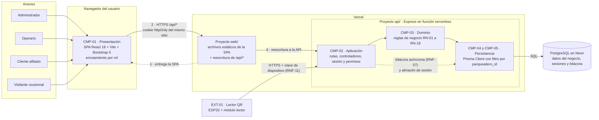
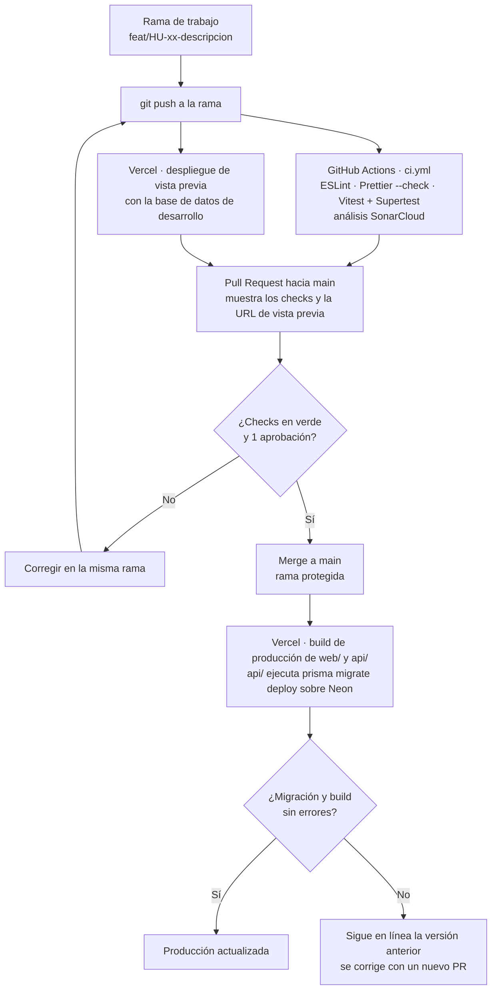

# APAR-CAR · Plataforma web de gestión de parqueaderos

> Repositorio `web-design-apar-car` · Competencia de Herramientas TIC · SENA, Tecnólogo en Análisis y Desarrollo de Software · Ficha **3229209**


**APAR-CAR** es una plataforma web para que los dueños de parqueaderos pequeños o comunitarios manejen su negocio en un solo lugar: celdas, tarifas, entradas y salidas con cobro automático, mensualidades, cartera y reportes. El cliente afiliado consulta su historial y el estado de su mensualidad sin tener que preguntarle al administrador.

> **Alcance:** APAR-CAR entrega **trazabilidad administrativa y control de acceso**, no seguridad física de los vehículos.

---

## Tabla de contenido

1. [Equipo](#1-equipo)
2. [Herramientas TIC integradas](#2-herramientas-tic-integradas)
3. [Stack tecnológico](#3-stack-tecnológico)
4. [Arquitectura](#4-arquitectura)
5. [Flujo de integración y despliegue continuo](#5-flujo-de-integración-y-despliegue-continuo)
6. [Modelo de datos (ER)](#6-modelo-de-datos-er)
7. [Recursos de la API](#7-recursos-de-la-api)
8. [Vistas de usuario](#8-vistas-de-usuario)
9. [Estructura del repositorio](#9-estructura-del-repositorio)
10. [Instalación y ejecución local](#10-instalación-y-ejecución-local)
11. [Flujo de trabajo con Git](#11-flujo-de-trabajo-con-git)
12. [Prototipo UI/UX](#12-prototipo-uiux)
13. [Seguridad del repositorio](#13-seguridad-del-repositorio)
14. [Documentación del proyecto](#14-documentación-del-proyecto)
15. [Video de presentación](#15-video-de-presentación)

---

## 1. Equipo

| Integrante | Rol en el proyecto | Herramienta TIC que presenta |
|---|---|---|
| Mariana Uribe Muñoz | Analista y líder | GitHub Actions (flujo de ramas, PR e integración continua) |
| Ismael Mira Correa | Desarrollo frontend | Vercel (despliegue continuo y vistas previas) |
| Valeria Usuga Penagos | Desarrollo backend | Prisma ORM + PostgreSQL (gestión de la base de datos) |

---

## 2. Herramientas TIC integradas

El proyecto integra **tres herramientas TIC**. Las tres ya estaban decididas en la documentación del proyecto (ADR-008 y HT-05), así que esta entrega no cambia el alcance.

| # | Herramienta | Para qué la usamos | Dónde se ve en el proyecto | Respaldo documental |
|---|---|---|---|---|
| 1 | **GitHub Actions** | Ejecutar ESLint, Prettier y Vitest en cada push y en cada Pull Request; bloquear el *merge* si algo falla. | `.github/workflows/ci.yml` y la pestaña *Checks* de cada PR | ADR-008, HT-05 |
| 2 | **Vercel** | Desplegar automáticamente el cliente (`web/`) y el servidor (`api/`). Cada PR recibe una URL de vista previa; cada *merge* a `main` publica en producción. | Comentario del bot de Vercel en cada PR | ADR-008, HT-05 |
| 3 | **Prisma ORM** (gestión de BD) | Definir el modelo de datos como código, versionar las migraciones y consultar PostgreSQL (Neon). Prisma Studio y pgAdmin para inspeccionar los datos. | `api/prisma/schema.prisma` y `api/prisma/migrations/` | ADR-008, HT-06 |

---

## 3. Stack tecnológico

| Capa | Tecnología |
|---|---|
| Lenguaje | JavaScript (Node.js 22 LTS) |
| Cliente | React 18 + Vite + Bootstrap 5 (react-bootstrap) |
| Servidor | Express |
| Persistencia | PostgreSQL en Neon + Prisma ORM |
| Autenticación | express-session (sesión almacenada en PostgreSQL) + bcrypt |
| Pruebas | Vitest + Supertest · Postman para pruebas manuales |
| Calidad | ESLint + Prettier + SonarCloud |
| Despliegue | Vercel (dos proyectos sobre este mismo repositorio) |

Toda marca de tiempo se guarda como `timestamptz` en UTC y se convierte a `America/Bogota` solo al mostrarla.

---

## 4. Arquitectura

**Monolito modular con cliente desacoplado** (ADR-010). El servidor concentra las capas de aplicación, dominio y persistencia en un solo despliegue; las reglas de negocio viven solo en el dominio. El cliente React es una aplicación aparte que habla con el servidor únicamente por HTTP. El lector QR es un participante externo.



**Cómo leerlo:** la SPA no corre en Vercel, corre en el navegador; Vercel solo la entrega (1). Las peticiones a `/api/*` salen hacia el mismo dominio del cliente (2) y Vercel las reescribe hacia el proyecto de la API (3), así la cookie de sesión es del mismo sitio (ADR-008). El lector QR llama a la API directamente, con su propia clave. La flecha punteada entre aplicación y persistencia es la excepción a la regla de capas: la bitácora (y el almacén de sesión) se escriben sin pasar por el dominio (ADR-010).

---

## 5. Flujo de integración y despliegue continuo

Así trabajan juntas las tres herramientas TIC desde que alguien abre una rama hasta que el cambio llega a producción. La migración de la base de datos corre dentro del build de producción de `api/`: si falla, Vercel no publica y sigue en línea la versión anterior. Las vistas previas usan una base de datos de desarrollo, nunca la de producción.



---

## 6. Modelo de datos (ER)

Modelo de la v1. Toda tabla operativa lleva `parqueadero_id` (multi-inquilino, ADR-001) y el filtro por parqueadero se deriva siempre de la sesión (RNF-02). Las únicas tablas globales son `USUARIO` (un correo, una cuenta en toda la plataforma, RN-18) y su `CONSENTIMIENTO`. Cada fila de `TARIFA` es una versión completa del tarifario (hora, día y mensualidad), de modo que un movimiento congela una sola referencia (RN-03). Se refina en el esquema de Prisma (HT-06).

```mermaid
erDiagram
    PARQUEADERO ||--o{ AFILIACION : "tiene"
    USUARIO |o--o{ AFILIACION : "activa"
    USUARIO ||--o{ CONSENTIMIENTO : "acepta"
    PARQUEADERO ||--o{ CELDA : "tiene"
    PARQUEADERO ||--o{ TARIFA : "versiona"
    PARQUEADERO ||--o{ VEHICULO : "registra"
    PARQUEADERO ||--o{ DISPOSITIVO : "autoriza"
    PARQUEADERO ||--o{ BITACORA : "audita"
    USUARIO |o--o{ BITACORA : "ejecuta"
    AFILIACION ||--o{ VINCULO_VEHICULO : "tiene"
    VEHICULO ||--o{ VINCULO_VEHICULO : "pertenece por"
    AFILIACION ||--o{ CODIGO_VINCULACION : "recibe"
    VEHICULO ||--o{ CODIGO_QR : "porta"
    AFILIACION ||--o{ PAGO : "registra"
    TARIFA ||--o{ PAGO : "fija el valor"
    CELDA ||--o{ MOVIMIENTO : "aloja"
    TARIFA ||--o{ MOVIMIENTO : "congela"
    VEHICULO |o--o{ MOVIMIENTO : "genera"
    USUARIO ||--o{ MOVIMIENTO : "registra"
    DISPOSITIVO |o--o{ MOVIMIENTO : "lee"

    PARQUEADERO {
        uuid id PK
        string nombre
        string direccion
        timestamptz creado_en
    }
    USUARIO {
        uuid id PK
        string correo UK "único global (RN-18)"
        string hash_contrasena "bcrypt (RN-09)"
        string nombre
        string telefono
        boolean debe_cambiar_contrasena "operario (HU-38)"
        int intentos_fallidos
        timestamptz bloqueado_hasta "RNF-01"
        boolean activo
    }
    CONSENTIMIENTO {
        uuid id PK
        uuid usuario_id FK
        string version_politica "RN-08"
        timestamptz aceptado_en
    }
    AFILIACION {
        uuid id PK
        uuid parqueadero_id FK
        uuid usuario_id FK "nulo hasta vincular (ADR-002)"
        enum rol "ADMINISTRADOR, OPERARIO, CLIENTE"
        enum estado "PENDIENTE_VINCULACION, ACTIVA, INACTIVA"
        string nombre_titular "lo captura el admin (HU-12a)"
        string telefono_titular
        timestamptz creado_en
    }
    CELDA {
        uuid id PK
        uuid parqueadero_id FK
        string codigo "único por parqueadero"
        enum tipo_permitido "CARRO, MOTO, MIXTA"
        enum estado "LIBRE, OCUPADA"
    }
    TARIFA {
        uuid id PK
        uuid parqueadero_id FK
        decimal valor_hora
        decimal valor_dia
        decimal valor_mensualidad
        timestamptz vigente_desde
        timestamptz vigente_hasta "nulo = vigente (RN-02)"
    }
    VEHICULO {
        uuid id PK
        uuid parqueadero_id FK
        string placa "normalizada (RN-04)"
        enum tipo "CARRO, MOTO"
    }
    VINCULO_VEHICULO {
        uuid id PK
        uuid parqueadero_id FK
        uuid afiliacion_id FK
        uuid vehiculo_id FK
        timestamptz fecha_inicio
        timestamptz fecha_fin "nulo = vigente (RN-07)"
    }
    CODIGO_VINCULACION {
        uuid id PK
        uuid parqueadero_id FK
        uuid afiliacion_id FK
        string hash_codigo "se muestra una vez (RN-05)"
        int intentos_fallidos "máx. 3"
        timestamptz vence_en "7 días"
        timestamptz usado_en
    }
    CODIGO_QR {
        uuid id PK
        uuid parqueadero_id FK
        uuid vehiculo_id FK
        string token UK
        enum estado "ACTIVO, REVOCADO (RN-17)"
        timestamptz emitido_en
        timestamptz revocado_en
    }
    MOVIMIENTO {
        uuid id PK
        uuid parqueadero_id FK
        uuid celda_id FK
        uuid tarifa_id FK "tarifa congelada (RN-03)"
        uuid vehiculo_id FK "nulo si es ocasional"
        uuid registrado_por FK "usuario"
        uuid dispositivo_id FK "nulo si es manual"
        string placa
        enum tipo_vehiculo "CARRO, MOTO"
        string codigo_tiquete UK "solo ocasional (RN-15)"
        enum origen "MANUAL, LECTOR_QR"
        timestamptz entrada_en
        timestamptz salida_en "nulo = abierto (RN-10)"
        decimal valor_cobrado "RN-14"
        boolean anulado
        string motivo_anulacion "RN-13"
    }
    PAGO {
        uuid id PK
        uuid parqueadero_id FK
        uuid afiliacion_id FK
        uuid tarifa_id FK "mensualidad vigente"
        decimal monto "valor completo (RN-11)"
        enum medio_pago "EFECTIVO, TRANSFERENCIA, OTRO"
        timestamptz fecha_pago
        timestamptz periodo_desde
        timestamptz periodo_hasta "rodante 30 días"
        boolean anulado
        string motivo_anulacion "RN-13"
    }
    DISPOSITIVO {
        uuid id PK
        uuid parqueadero_id FK
        string nombre
        string hash_clave "RNF-11"
        boolean activo
    }
    BITACORA {
        uuid id PK
        uuid parqueadero_id FK
        uuid usuario_id FK "nulo si actúa un dispositivo"
        string accion
        string entidad
        json detalle
        timestamptz creado_en "solo anexable (RNF-07)"
    }
```



---

## 7. Recursos de la API

La API gestiona más de cuatro recursos. Todos viven bajo `/api` y, salvo la consulta pública del tiquete, exigen sesión.

| Recurso | Ruta base | Operaciones principales | Roles |
|---|---|---|---|
| Autenticación | `/api/auth` | registro, inicio y cierre de sesión, recuperación de contraseña | Todos |
| Celdas | `/api/celdas` | crear, listar, ver ocupación | Administrador · Operario (lectura) |
| Tarifas | `/api/tarifas` | crear versión, consultar vigente e histórico | Administrador |
| Clientes y afiliaciones | `/api/afiliaciones` | registrar, listar, desactivar, generar código de vinculación | Administrador |
| Vehículos | `/api/vehiculos` | registrar, asociar, cerrar vínculo, emitir/revocar QR | Administrador |
| Movimientos | `/api/movimientos` | registrar entrada, registrar salida y cobro, anular | Administrador · Operario |
| Pagos | `/api/pagos` | registrar, anular, historial, estado de cartera | Administrador · Cliente (lectura propia) |
| Reportes | `/api/reportes` | ingresos, ocupación, movimientos | Administrador |
| Tiquete público | `/api/tiquetes/:codigo` | consultar estado del tiquete | Sin sesión (límite por IP) |
| Lector QR | `/api/lector/lecturas` | recibir lectura del dispositivo | Dispositivo con clave |

La colección de Postman con todas las rutas se publica en `docs/postman/`.

---

## 8. Vistas de usuario

| Vista | Usuario | Qué permite |
|---|---|---|
| Inicio de sesión y registro | Persona nueva y usuarios registrados | Crear cuenta, ingresar y ser dirigido al panel de su rol |
| Panel del administrador | Administrador | Celdas y ocupación, tarifas, clientes y vehículos, cartera, reportes y bitácora |
| Panel del operario | Operario | Registrar entradas y salidas, ver ocupación y vehículos adentro |
| Portal del cliente | Cliente afiliado | Historial del vehículo, estado de la mensualidad y pagos |
| Consulta de tiquete | Visitante ocasional | Ver tiempo y valor acumulado con el código de entrada |

---

## 9. Estructura del repositorio

```text
web-design-apar-car/
├── .github/
│   ├── workflows/
│   │   └── ci.yml               # GitHub Actions: lint + pruebas en cada push y PR
│   └── pull_request_template.md
├── api/                         # Servidor Express (proyecto de Vercel #1)
│   ├── prisma/
│   │   ├── schema.prisma        # Modelo de datos (sección 6)
│   │   └── migrations/
│   ├── src/
│   │   ├── aplicacion/          # rutas y controladores
│   │   ├── dominio/             # reglas de negocio
│   │   └── persistencia/        # acceso a datos con Prisma
│   ├── tests/
│   ├── .env.example
│   └── package.json
├── web/                         # Cliente React + Vite (proyecto de Vercel #2)
│   ├── src/
│   │   ├── vistas/
│   │   ├── componentes/
│   │   └── servicios/           # cliente HTTP con credenciales de sesión
│   ├── vercel.json              # redirección de /api/* hacia el servidor
│   └── package.json
├── docs/
│   └── postman/
└── README.md
```

---

## 10. Instalación y ejecución local

**Requisitos:** Node.js 22 LTS, npm y una base de datos PostgreSQL (Neon o local).

```bash
# 1. Clonar
git clone https://github.com/USUARIO/web-design-apar-car.git
cd web-design-apar-car

# 2. Servidor
cd api
cp .env.example .env          # completar los valores
npm install
npx prisma migrate dev        # crea las tablas
npm run dev                   # http://localhost:3000

# 3. Cliente (en otra terminal)
cd web
npm install
npm run dev                   # http://localhost:5173
```

**Variables de entorno** (`api/.env.example`, sin valores reales):

```env
DATABASE_URL=
SESSION_SECRET=
CLIENT_ORIGIN=http://localhost:5173
NODE_ENV=development
```

| Comando | Qué hace |
|---|---|
| `npm run lint` | Revisa el código con ESLint |
| `npm run format` | Formatea con Prettier |
| `npm test` | Corre las pruebas con Vitest |
| `npx prisma studio` | Abre el visor de datos de Prisma |

---

## 11. Flujo de trabajo con Git

- **`main`** es la rama de producción y está **protegida**: no se hace push directo.
- Todo cambio entra por **Pull Request** con **una aprobación** de otro integrante y los **checks de GitHub Actions en verde**.
- Nombre de ramas: `tipo/HU-xx-descripcion-corta`.

| Prefijo | Uso | Ejemplo |
|---|---|---|
| `feat/` | Funcionalidad nueva | `feat/HU-07-registrar-celdas` |
| `fix/` | Corrección | `fix/HU-21-calculo-minimo` |
| `chore/` | Configuración e infraestructura | `chore/HT-05-ci-vercel` |
| `docs/` | Documentación | `docs/readme-diagramas` |

**Mensajes de commit** (Conventional Commits): `feat(celdas): registrar celda con tipo permitido`.

---

## 12. Prototipo UI/UX

🔗 **Figma:** _[enlace pendiente]_

El prototipo cubre las vistas de la sección 8.

---

## 13. Seguridad del repositorio

Este repositorio es **público**, por exigencia de la competencia. Por eso:

- Ninguna credencial, cadena de conexión ni dato real se versiona. La configuración sensible va en variables de entorno (en Vercel y en `.env`, que está en `.gitignore`).
- Solo se publica `.env.example` sin valores.
- Están activados el **escaneo de secretos** y la **protección de push** de GitHub.
- El historial se revisa antes de cada entrega.

> Pendiente de documentación: actualizar el RNF-10 del backlog, que hoy exige repositorio privado.

---

## 14. Documentación del proyecto

La fuente de verdad de requisitos, historias de usuario, reglas de negocio y decisiones de arquitectura es el **Backlog del producto** (47 historias, 8 épicas, 10 ADR).

| Documento | Ubicación |
|---|---|
| Backlog del producto | _[enlace pendiente]_ |
| Decisiones de arquitectura (ADR) | Hoja *Decisiones (ADR)* del backlog |
| Colección de Postman | `docs/postman/` |

---

## 15. Video de presentación

🎥 _[enlace pendiente]_ · Máximo 5 minutos, con la participación de los tres integrantes explicando la integración de las herramientas TIC.
